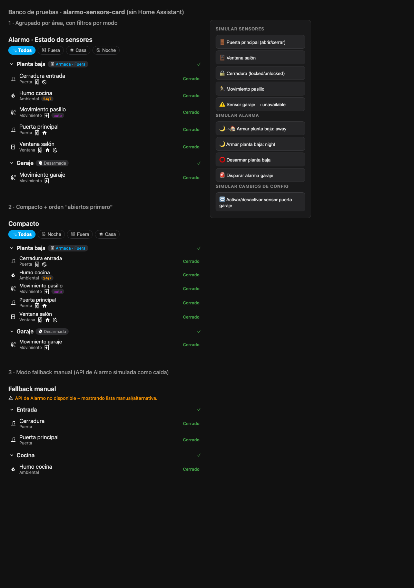

# alarmo-sensors-card

Tarjeta personalizada de Lovelace para **visualizar el estado de todos los sensores configurados en [Alarmo](https://github.com/nielsfaber/alarmo)**, agrupados por área y con filtro por modo de armado (Fuera, Casa, Noche, Vacaciones, Personalizado).

**No modifica nada de Alarmo**: solo consume su API WebSocket existente (`alarmo/sensors`, `alarmo/areas`, `alarmo/entities`, `alarmo_config_updated`), la misma que usan el panel de configuración de Alarmo y la tarjeta oficial.



## Características

- ✅ Estado en vivo de cada sensor (Abierto/Cerrado/No disponible), leído de `hass.states` (misma lógica que Alarmo: `on`/`open`/`unlocked` = abierto).
- ✅ Iconos por tipo de sensor (puerta, ventana, movimiento, manipulación, ambiental, otro) — los mismos que el frontend oficial de Alarmo, cambiando a su variante "activa" cuando el sensor se abre.
- ✅ Agrupación por área (colapsable), con chip de estado de la alarma de cada área (`Armada · Noche`, `Desarmada`, `DISPARADA`…).
- ✅ Filtro por modo con chips; contador de abiertos por área.
- ✅ Badges: `Desactivado`, `24/7` (`always_on`), `Bypass` (`bypassed_sensors` / `auto_bypass`).
- ✅ Iconos de los modos en los que participa cada sensor.
- ✅ Clic en un sensor → diálogo *more-info* de HA.
- ✅ Interfaz en español/inglés según el idioma de HA.
- ✅ **Robusta ante cambios**: si la API de Alarmo no responde o cambia de forma, la tarjeta no se rompe — muestra un aviso y funciona con una lista manual/alternativa, reintentando cada 60 s. Si cambias la configuración de Alarmo, la tarjeta se recarga sola (suscripción `alarmo_config_updated`).

## Instalación

### Opción A · Con HACS (recomendada)

Si el repositorio está publicado en GitHub (ver [Distribución](#distribución--publicarlo-en-github)):

1. HACS → ⋮ → **Repositorios personalizados** → añade la URL del repo con categoría **Lovelace**.
2. Busca "Alarmo Sensors Card" en HACS y pulso **Descargar**.
3. Recarga el navegador. HACS registra el recurso `/community/alarmo-sensors-card/alarmo-sensors-card.js` automáticamente.

Para actualizaciones, publica una nueva release en GitHub y HACS la detectará.

### Opción B · Manual (un solo archivo)

1. Copia `alarmo-sensors-card.js` a tu configuración de HA:

   ```
   <config>/www/alarmo-sensors-card.js
   ```

   (por Samba, Studio Code Server, `git`… lo que uses normalmente).

2. Registra el recurso: **Ajustes → Dashboards → ⋮ (menú) → Recursos → + Añadir**

   - URL: `/local/alarmo-sensors-card.js`
   - Tipo: `Módulo de JavaScript`

3. Refresca el navegador (Ctrl+F5 / Cmd+Shift+R) y añade la tarjeta a cualquier dashboard con el selector visual o por YAML.

> No requiere HACS, ni dependencias, ni build: es un único archivo.
> La tarjeta es de solo lectura; no necesita permisos de administrador.

## Configuración

```yaml
type: custom:alarmo-sensors-card
title: "Alarmo · Estado de sensores"   # opcional
group_by: area                          # area (defecto) | none
sort: name                              # name (defecto) | open_first
areas: []                               # opcional: limitar áreas por id o nombre
modes: []                               # opcional: limitar los chips de filtro
show_disabled: false                    # mostrar sensores desactivados en alarmo
compact: false                          # filas más densas
show_more_info: true                    # clic abre el diálogo more-info
```

### Modo fallback manual (flexibilidad)

Si algún día la API interna de Alarmo cambiara, puedes seguir usando la tarjeta dándole tú la lista:

```yaml
type: custom:alarmo-sensors-card
title: "Sensores (manual)"
entities:
  - entity: binary_sensor.puerta_principal
    name: Puerta principal
    type: door          # door|window|motion|tamper|environmental|other
    area: Entrada
    modes: [armed_away, armed_night]
    always_on: false
# o bien, por expresión regular sobre entity_id / friendly_name:
# include: "^binary_sensor\\.(puerta|ventana)"
```

En modo manual, si `modes` no se especifica no se aplicará filtro por modo (se muestran todos los chips disponibles según la configuración global).

## Distribución / Publicarlo en GitHub

Estructura del repo (ya preparada en esta carpeta):

```
alarmo-sensors-card/
├── alarmo-sensors-card.js   ← la tarjeta (raíz del repo)
├── hacs.json                ← metadatos de HACS
├── README.md
├── LICENSE
├── dev/                     ← banco de pruebas (opcional)
└── screenshots/
```

Pasos para publicar y que aparezca en HACS como repositorio personalizado:

```bash
cd alarmo-sensors-card
# si aún no es un repo git:
git init && git add -A && git commit -m "v0.1.0"
git remote add origin git@github.com:TU_USUARIO/alarmo-sensors-card.git
git push -u origin main            # o master, según tu rama

# crear la primera release (HACS la usa para versionar):
gh release create v0.1.0 --title "v0.1.0" --notes "Primera versión"
# (o desde github.com → Releases → Draft new release → tag v0.1.0)
```

Al publicar una versión nueva:

1. Sube `CARD_VERSION` dentro de `alarmo-sensors-card.js`.
2. Commit + `git tag v0.1.x` + nueva release.
3. Los usuarios de HACS verán la actualización (tras recargar, la tarjeta se sirve con caché: conviene refresco forzado).

### Empaquetado rápido (zip)

```bash
zip -r alarmo-sensors-card-v0.1.0.zip alarmo-sensors-card \
    -x "alarmo-sensors-card/.git/*"
```

El zip contiene todo lo necesario para compartirlo por cualquier medio o archivarlo.

## Probar sin tocar tu instancia

Banco de pruebas incluido (mock de `hass` con datos de ejemplo idénticos a los que devuelve la API real):

```bash
cd alarmo-sensors-card
python3 -m http.server 8931
# abrir http://localhost:8931/dev/index.html
```

El panel lateral permite simular: abrir/cerrar sensores, armar/desarmar/disparar la alarma, sensores `unavailable`, y cambios de configuración de Alarmo en vivo. También hay un modo automático: `dev/index.html?step=N` (N=1..4) ejecuta una secuencia de interacciones.

## Probar en tu instancia de Home Assistant

1. **Recurso estático (recomendado)**: sube el archivo a `config/www/`, registra `/local/alarmo-sensors-card.js` como recurso y añade la tarjeta a un dashboard de prueba. Para iterar: sustituye el archivo y haz recarga forzada.
2. **Desarrollo en vivo**: sirve el archivo en tu máquina (`python3 -m http.server 5000`) y registra como recurso `http://localhost:5000/alarmo-sensors-card.js`. Funciona si accedes a HA desde esa misma máquina y sin HTTPS (o con excepción de contenido mixto).
3. **Validar los datos reales antes de instalar**: si tu instancia es accesible desde este entorno, puedes verificar la respuesta exacta de `alarmo/sensors` / `alarmo/areas` con un token de acceso de larga duración (Perfil → Seguridad). *Crea un token temporal y revócalo después: otorga acceso completo a tu HA.*

## Compatibilidad

Probado contra el código de `alarmo` en este repositorio (rama main). Los campos que consume (`entity_id`, `type`, `modes`, `area`, `enabled`, `always_on`, `auto_bypass`, y `areas[].{area_id,name,modes[].enabled}`) existen desde hace muchas versiones. Si un campo falta o cambia, la tarjeta lo tolera (`??`/valores por defecto en todos los accesos).
